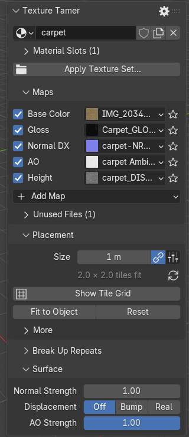

# Texture Tamer

A Blender add-on that turns any downloaded PBR texture set into a finished material in
one step, even when the file names are messy. Pick a folder, a zip or any one image of
the set (or drag it in), and every map is recognised, wired with the right colour space
and placed at real-world size. Works in EEVEE and Cycles; the material uses only
Blender's own nodes, so it keeps working without the add-on.

(Called "PBR Quick Apply" up to version 1.1.1.)

## Install

1. Download `texture_tamer-<version>.zip` from the
   [Releases](https://github.com/Dheer20/texture-tamer/releases) page.
2. Blender: **Edit > Preferences > Get Extensions**, top-right drop-down
   **Install from Disk...**, pick the zip.
3. Press **N** in the 3D Viewport (or Shader Editor): tab **Texture Tamer**.

Needs Blender 5.2 or newer (tested on 5.2.3 and 5.3.0). Coming from "PBR Quick Apply":
remove it first (Preferences > Add-ons > PBR Quick Apply > Uninstall); materials made
with it keep their settings.

## Use

1. Select one or more objects.
2. **Apply Texture Set...** and pick a **folder**, **one image** of the set (the rest is
   found), several images, or a **.zip** (unpacked next to the zip). Or **drag** the
   files into the 3D Viewport or Shader Editor.
3. Done: the material goes into each selected object's active material slot.

To check the guesses first, untick **Apply Right Away** in the file browser's side bar,
fix any row in the list that appears, then **Apply to Selected**.
Hover over any button for an explanation. Everything is undoable (Ctrl+Z).

### Material
The top row is Blender's own material field (rename, browse, new, unlink).
**Material Slots** (folded) is the same slot list as the Material tab.

### Maps (default layout: By Channel)
One line per material input: tick box (use / skip), the input's name, the file feeding
it (click to pick another file, choose **None**, or switch *Gloss ↔ Roughness* and
*DirectX ↔ OpenGL* normal), and a star to **show only this map** on the object.
**Add Map** fills an empty input; files not used sit under **Unused Files**, each with
**Use As**.

### Placement (default layout: Size First)
- **Size**: real width of one repeat; the chain keeps the texture's shape (off = separate
  height); the preset icon has 0.25–2 m, 1/2/4 ft, **From Texture Info** (when the set
  has a JSON with `tile_size_m`) and your own saved sizes.
- **"2.0 × 2.0 tiles fit"** on the selected object; the round arrow re-measures the UVs.
- **Show Tile Grid**: blue/white squares, one per repeat. Switch it off before rendering.
- **Fit to Object** (whole tiles across; change the count in Adjust Last Operation) and **Reset**.
- **More**: Projection (*UV Map*, *Box* = no unwrap needed, *World* = continues across
  objects), Off / Tiles / Metres grid, Rotation with quarter turns, Offset.

### Break Up Repeats
Random **Shift** / **Turn** per object, and a large **Variation Map** multiplied over the
colour (found automatically when named like `*tint*`/`*macro*` next to the set).

### Surface
Normal / bump strength, **Displacement Off** by default (*Bump* = fake detail, *Real* =
moves the surface; depth and midlevel come from the set's JSON when present), AO and
emission strength, **Subdivide for Displacement**.

### Layouts
The gear icon in the panel header opens the add-on's preferences:
- **Maps**: By Channel (default), Quiet List, Picture Grid, Full List.
- **Placement**: Size First (default), Header Buttons, Classic.

## What it does with each map

| Map | Wiring | Colour space |
|---|---|---|
| Base colour / albedo / diffuse | Base Color (× AO, × variation map) | sRGB |
| AO | multiplied over base colour, strength slider | Non-Color |
| Roughness / Gloss | Roughness (gloss inverted) | Non-Color |
| Metallic, Specular | Metallic, Specular IOR Level | Non-Color |
| Normal OpenGL / DirectX | Normal Map node (DirectX: green flipped) | Non-Color |
| Height (8/16-bit, EXR) | Off by default; Bump or Real displacement | Non-Color |
| Bump | Bump node on top of the normal map | Non-Color |
| Emission | Emission Color, strength slider | sRGB |
| Opacity | Alpha | Non-Color |
| Packed ARM / ORM | split: R → AO, G → roughness, B → metallic | Non-Color |

## Names it recognises

Words are split at `_ - . space` and CamelCase, numbers dropped, and the map word is
looked for from the end of the name (so `metal_plate_diff` is colour); glued names like
`wallpaperalbedo` work too. Covers ambientCG, Poly Haven, Poliigon, FreePBR,
Megascans-style and Substance/Unreal exports (see `RESEARCH.md`, `tests/test_names.py`).
Duplicates: the picked set, OpenGL over DirectX, higher resolution, PNG/EXR/TIFF over JPG
win; the rest stay listed as unused.

## Known limits

- A normal map without dx/gl in its name is taken as OpenGL; switch it if bumps look
  inside-out.
- Real displacement needs enough geometry (Subdivide button or Cycles adaptive
  subdivision).
- Box/World projection: normal maps only approximately right on the sides; rotation shows
  on floors and ceilings only.
- Show Tile Grid and "show only this map" are part of the material and show in renders.
- Rebuilding (changing a map) replaces that material's nodes; hand edits are lost.
- UDIM sets, specular-workflow conversion, cavity / translucency / fuzz maps: not handled.

## Tests

`python tests/test_names.py` checks the name guesser (no Blender needed).
`sh tests/run_tests.sh` builds the zip, installs it into a throw-away Blender profile and
runs the headless Blender tests; those need local texture sets (`TT_TEST_SETS`) and the
small copies made by `tests/make_messy_sets.py`.

## License and commercial use

Copyright (C) 2026 Dheer. Texture Tamer is free software under the
**GNU General Public License v3.0 or later** (see `LICENSE`), the licence Blender
requires for add-ons that use its Python API. Anyone may use it, including commercially.
If it saves your studio or business time, please support its development by buying a
supported copy (store link coming soon).
